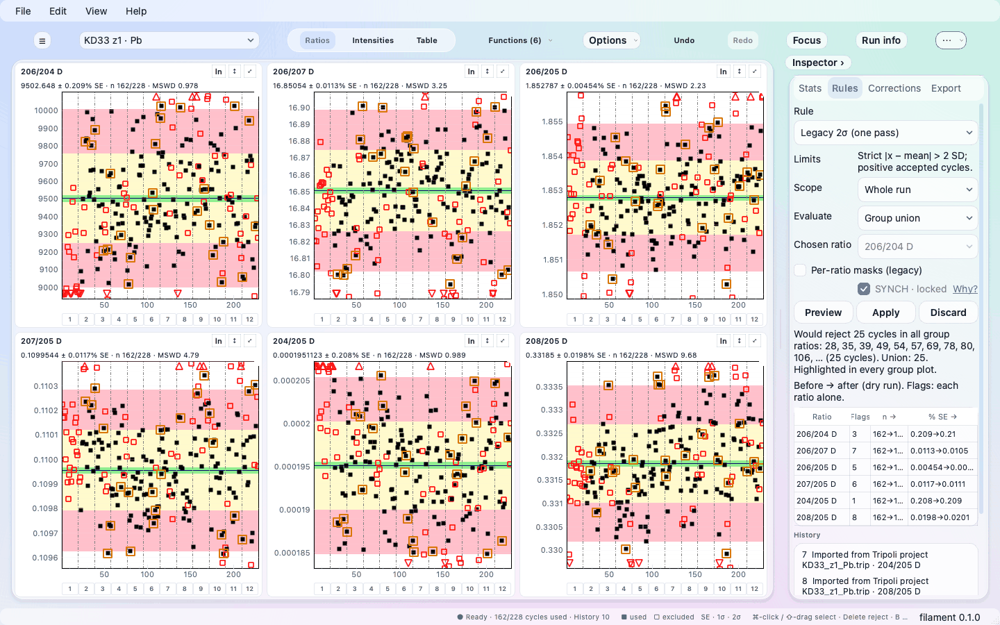
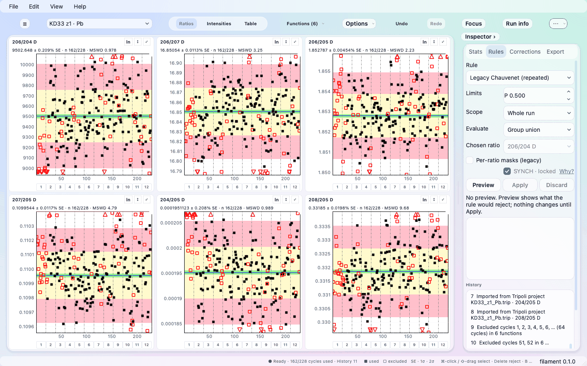
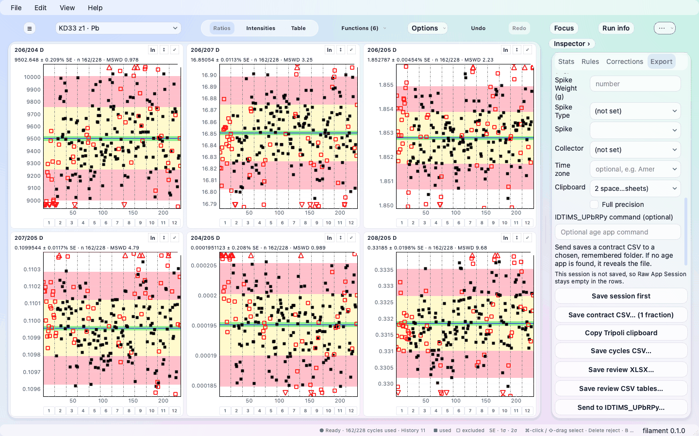
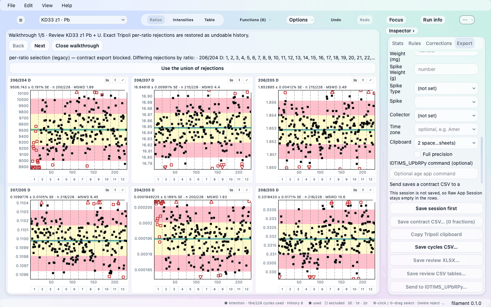
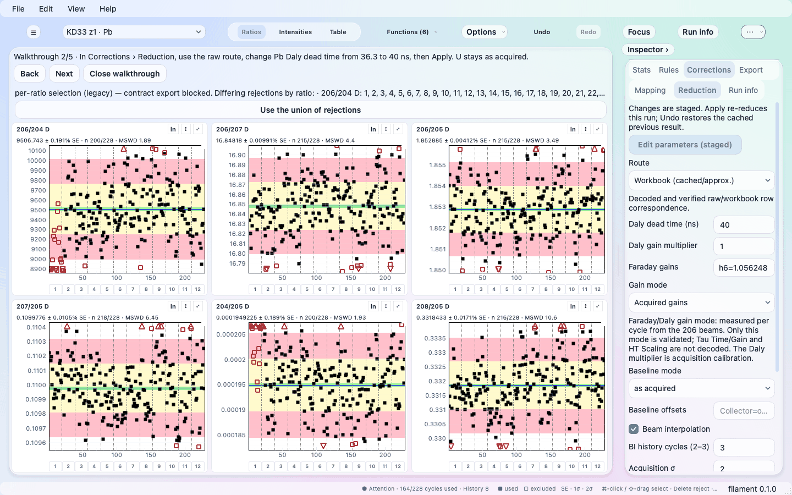

# User guide

Use filament to review measured cycles, then send ratios to your age reduction app.
Dates are calculated in IDTIMS_UPbRPy. The name remains a working name; the chosen icon is the rhenium ribbon with a glowing bead.

## Open a run

Choose **File → Open Files…** for an IonVantage `.xls`, IsoLinx `.TIMSDP`, or legacy
`.trip` project. You can drag files into the window. Choose **Open Folder…** for an
acquisition folder or a `.raw` directory; the app finds its cached workbook.
A `.raw` directory needs that workbook to open.

Processed **Triton EXP**, **Nu TIMS individual-answers TXT**, **Neptune EXP**
and the **EARTHTIME ID-TIMS cycle CSV template** also open here. Detection uses
the exact report heading/header, even if the file has another extension. These
contain instrument-processed functions. They do not enable generic raw reduction.

The cycle CSV template is separate from the fractions CSV hand-off. Fill its
sample, fraction, date (`mm/dd/yyyy`), cycles per block and function/cycle table.
Zero cycles per block means a single block. Legacy template semantics number
rows from one, clamp nonpositive values to zero and pad the final block with
invalid zeros. Source cycle labels and padding count remain in metadata. The
unfilled template reports that cycle data must be added.

Triton/Neptune **X** flags are retained without automatic rejection. **D**, blank
and `Invalid Norm` cells are missing and cannot enter statistics; a D-prefixed
numeric payload remains visible as invalid. Hover a cycle value to see its source
token, and check **Run info** for flag counts and time/block interpretation.
Triton uses the pinned Java fallback of ten cycles per block when the file has
no declared block size. Neptune report rows form one review block. Nu uses its
declared measurements per block and has no recorded cycle time. UCDavis clock
strings are shown as seconds; their original strings remain available.

Cr, Sr, Nd and other runs without Pb/U assignments open an **independent run
review** window with the existing plot and cycle table. Select any function,
sculpt points/blocks, choose arithmetic or geometric-ratio statistics, use the
selected function's **X flags**, and **Undo** edits. **Source and flags** retains
the source tokens. **Save cycle CSV…** records reviewed values and include masks.
These windows are temporary and do not enter a saved fraction session. Save their
cycle CSV before closing. Pb/U runs retain the normal workspace/session workflow.

The `/1` fraction contract still requires its existing Pb/U ratios and valid
mapping. Other isotope systems have cycle export only; importing a vendor file
alone does not establish an exportable Pb/U mapping. See
[processed format coverage and Java comparison limits](p5-processed-parsers.md).

Choose a fraction and **Pb** or **U** in the top picker. Opening a new run does not
reject cycles. A `.trip` restores its saved, per-ratio rejections as undoable edits.
If its source is missing, use **Locate…** and choose the named workbook. Do not
substitute a similarly named acquisition.

## Review the plots

Choose **Ratios**, **Intensities**, or **Table** in the top bar. Use **Functions** to
choose what you plot. Each plot shows its mean, 1σ % SE, accepted count and block
MSWD. Filled points are used; hollow red points are excluded; crosses are invalid.
The line is the mean, and the bands show SE, 1σ and 2σ.

The wall’s **Stacked | Auto-fit** switch (also in **View**) remembers your choice.
Stacked is the default: full-width plots share cycle labels on the bottom plot
and one block strip below the wall. Auto-fit chooses columns from the available
width, with a block strip per card. Both scroll vertically when needed; switching
keeps your selections, masks and plot state.

The light and dark themes use the lab suite's quiet surfaces and filament accent.
Ratios / Intensities / Table form a segmented view switch; inspector tabs use an
underline, and the numbered workflow rail connects the existing steps. Undo,
Redo and Reset keep their short text labels, with the full action as tooltip and
accessible name. **Save contract CSV…** is the filled primary action in Export.

Plot colours follow legacy Tripoli independently of the interface accent: black
filled accepted squares, red hollow excluded squares, a blue automatic mean,
pink 2σ, pale yellow 1σ and green SE bands in light mode. Dark mode retains those
hue meanings with contrast adaptations. Ratio and intensity cards use the same
inclusion convention. See [plot colour provenance](plot-colours.md) for the
verified sources and accessibility details.

Use **ln** for a plot's log scale, **↕** to fit its vertical range, and **⤢** to
maximise it. Drag the inspector splitter to resize it. **Focus** (⌘⇧F) folds the
inspector; click it again to restore it. Use the left menu to unfold fractions.

### Tripoli controls

The action bar beside **Stacked | Auto-fit** keeps these controls visible. Existing
menus, shortcuts, Rules controls and hover tools remain available.

| Tripoli name | filament control |
| --- | --- |
| SYNCH | **SYNCH**; checked and locked for contract ratios, switchable for free functions. This controls edits, rather than copying one plot's mask to others. |
| Chauvenet | Wall **Chauvenet…** opens Rules with Java Chauvenet selected; mapped-ratio card **Ch** also chooses that ratio for evaluation. Rejections stay shared. Choose whole-run/per-block scope, then **Preview → Apply**. Other filters remain in Rules. |
| Restore plot / Replot All | Card **↺** / wall **Restore** resets the view and keeps rejections. |
| Reset All Data / legacy Restore | **Reset data…** includes every cycle and block of the current run, with confirmation and Undo. |
| Ignore Rejects | **Fit all** off fits accepted valid cycles; on includes excluded points in fitting. Rejections and statistics stay unchanged. |
| Log / Toggle ratio-logRatio | Wall **Log** / card **ln** changes the display only. |
| Toggle ALL Sculpting | Wall **Sculpt** selects Review mode in every plot; **Pan** or **Zoom** leaves it. Card **✎** toggles Review/Pan for that plot. |
| Tile / Stack | **Auto-fit / Stacked**. |
| Block include/exclude | Numbered block strip; Shift-click or drag for a range. Also **B**, plot context menu, or double-click a Stats block row. |
| Toggle block means / Toggle stats | Wall **Stats** opens block statistics; plot overlay toggles are not implemented. |
| Invert / Select all / Show all / INCLUDE | **Corrections → Mapping** supports inverse mappings; wall **Plots** shares the **Functions** menu. Independent plot inversion, bulk Tripoli selectors and legacy discard-display modes are not implemented. |

## Reject cycles

Click a point or drag a box to toggle cycles. Use ⌘-click or ⇧-drag to select
without toggling; Delete rejects the selection. Click a numbered block in the
strip below a plot to toggle that block; drag across the strip for several blocks.
The mapped ratios share a selection so their correlations remain meaningful.
**Undo** restores your previous selection; **Redo** reapplies it.

## Read block statistics

Choose **Stats** in the inspector. Select a function under **Blocks of** to see its
block means, SE, % SE and accepted counts. Double-click a row to toggle its block.
The weighted block mean and **MSWD of block means** are diagnostics. The fraction
export continues to use the cycle mean, even when you inspect block statistics.

## Check acquisition information

Choose **Run info** in the top bar, or **Corrections → Run info**. Read the method,
source, acquisition settings and current route before changing parameters.

## Check warnings

Select the U run and read **Run info**. A warning can describe the mislabeled U
`270/267` intensity column, a duplicated terminal workbook row, or an unavailable
raw method. Warnings also travel into export provenance. A successful workbook
comparison does not validate the physical detector calibration.

## Preview a 2σ rule

Choose **Rules → Legacy 2σ (one pass)**. Choose **Whole run** or **Per block**, then
**Group union** for shared rejection. Press **Preview**. Amber points mark the
proposal; the accepted cycles have not changed. **Discard** removes the preview.

Legacy 2σ compares currently accepted positive values with their arithmetic mean
and SD once. It differs from the separate iterative k-σ option.

## Apply Chauvenet rejection

Choose **Legacy Chauvenet (repeated)**, set P (normally 0.5), then **Preview**.
Inspect the proposed exclusions and press **Apply** to record exactly that proposal.
Use **Undo** to reverse it. This rule removes the worst point and recalculates
repeatedly; **Java Chauvenet (one pass)** is a different option, with a minimum count.

Leave **Per-ratio masks (legacy)** off for shared export. If a restored `.trip` has
different masks, **Use the union of rejections** adopts shared cycles and changes
the means. You can undo it. Ordinary contract and review-table exports require it.

## Change reduction parameters

Choose **Corrections → Reduction**. Expand **Edit parameters (staged)**. Select
**Raw acquisitions** only when the panel reports verified raw/workbook correspondence.
Otherwise read the reason and use the labeled workbook approximation where supported.

Edit dead time, gain, baseline, beam interpolation, acquisition rejection or oxide
settings, then press **Apply**. Editing fields alone does not change the result.
Scroll to read the parameter and ratio diff. Collapse the editor to give the diff
more room. **Discard** drops staged edits; **Reset** stages the acquired settings
for another Apply. Undo/Redo restores calculated values and parameters together.

## Save your session

Choose **File → Save Session…** (⌘S) before export. The session records selection,
mapping, parameters and history, and checks source hashes when reopened. Keep your
source files available. An unchanged saved session adds its link to the contract;
unsaved edits leave that link empty. **Save session first** saves both in sequence.

## Export ratios and review tables

Choose **Export**. Resolve every listed problem, confirm the fraction ID, spike,
weights, collector and time zone, and check the preview. Scroll inside the panel
for metadata fields. Choose **Save contract CSV…** for `idtims-fractions/1`,
**Save review XLSX…** for Fractions/Cycles/Provenance sheets, or **Save review CSV
tables…** for the same tables as files. **Save cycles CSV…** writes the current run
with inclusion flags. **Copy Tripoli clipboard** uses the legacy eight-significant-
digit format unless you choose full precision.

## Exchange with Tripoli and ET_Redux

The **Exchange** menu has separate compatibility files for the selected analysis.
The existing contract CSV, clipboard, cycles CSV and review XLSX keep their formats.

- **Save Tripoli cycle TSV…** writes the Java `00dc941` padded tab-delimited
  layout, source/derived function order and `&value&` rejection markers. It keeps
  the source's `NaN`/`&NaN&` behavior for missing values, despite the upstream
  header's promise of blank entries. Cycle/time fields precede the functions.
- **Save OGTripoli ratio text…** writes ratio columns with signed rejections,
  block separators, E9 precision and Windows CRLF/en-US dates. Its header uses
  OGTripoli's arithmetic statistics, regardless of the current report mode;
  this does not change the analysis. Regular blocks are required. Three-row
  correction labels follow the source splitting/padding, while malformed
  labels and negative measured values are refused.
- **Save ET_Redux measured XML…** writes one Pb or U analysis in the pinned
  `ETReduxFraction` / `MeasuredUserFunction` schema (XML names
  `UPbReduxFraction` / `MeasuredUserFunctionModel`). Supply Sample and Fraction ID,
  a complete measured-ratio mapping, shared cycles and at least two accepted
  cycles per exported function. A completed end marker or complete planned
  cycle count is required; aborted and unknown-completion runs are refused.
  Instrument-corrected U functions must have known r18. Values use the current
  statistic and oxide settings; no fractionation correction is added. Unmapped
  ratio slots remain zero as in Tripoli; uniquely named additional measured
  ratios are included without deriving ratios from means.

Choose the destination file explicitly. Replacing an existing exchange file
requires a separate **Replace export?** confirmation, with **No** selected by
default. This is manual file export; folder watching and ET_Redux services are
not configured.

## Choose report columns and defaults

Open **Exchange → Report columns and templates…** for a processed-analysis
summary. Check columns, edit their category labels, and use **Move up/down** to
order them. **Preview** shows the selected fields; **Save report CSV…** writes
category and column header rows followed by one row per function. SE is always
1σ; geometric absolute SE is the smaller absolute side corresponding to the
displayed percent SE. Available fields include function/unit, mean, SE, counts,
statistic, method and source. No units are inferred when the source lacks them.

**Save template…**, **Load** and **Delete** manage named templates for the
selected method, with global templates available as fallbacks. Choose
**All methods (fallback)** to manage global templates. Select the scope before
**Apply preference**: the effective choice is analysis, then session, then
method, then global, then the built-in Cycle summary. The top line identifies
the effective source. **Restore inherited** removes only the selected override.
Session/analysis choices travel in native session presentation metadata;
method/global choices remain local user preferences. These preferences affect
report display/export only and never set numerical defaults or masks.

Java's **Template 1** renderer is scaffolded, but its GUI export remains
unavailable: processed cycle files do not contain its Phoenix Full species,
weighted-ratio and gain results. Cycle means are not substituted for those fields.

## Inspect legacy saved work

**Exchange → Inspect OGTripoli text…** reads processed OG text into a read-only
cycle table. It retains signed per-function masks, missing cycles, blocks and
all six function-header/statistics rows. **Save inspection JSON…** preserves
the original bytes, SHA-256 and inert data graph. The original-data CSV import
template is a different format and is not accepted by this action.

**Inspect legacy saved work…** accepts `.trip`, `.triphis` and Java `.tripoli`.
The existing `.trip` acquisition replay remains available through Open; this
inspector applies no settings, corrections or paths. History roots are parsed
as bounded .NET record data. Java support is a bounded scaffold for the pinned
Session UID, scalar fields, strings, nulls and primitive arrays. Non-null
analysis maps, custom serialized classes, other versions and unknown tokens
are refused. No Java objects are executed. Unknown fields and original bytes
are preserved in the inspection JSON. No binary file is written back.
Representative saved sessions/history and reference-app reopens are still
needed before claiming complete binary migration.

**File → Open Recent** also contains **Run files** and **Folders**, each with
eight deduplicated entries and a clear action. Missing paths are omitted;
reopening is explicit. Native session recents remain separate.

## Send to IDTIMS_UPbRPy

Choose **Send to IDTIMS_UPbRPy…** and a destination folder. The app saves a contract
CSV and opens the age app when it finds it. If it cannot, it reveals the saved file
so you can open it yourself. To choose a specific command, scroll to **IDTIMS_UPbRPy
command (optional)**. It runs without a shell and receives `--open PATH`.

## Walkthrough: open KD33 z1

Choose **Help → Walkthrough: change the dead time**. If unavailable, choose
**Help → Choose walkthrough examples folder…** and point to the read-only Boise
examples. Step 1 opens KD33 z1 Pb and U with the exact legacy per-ratio masks.
Keep those masks while comparing the reference numbers below.

## Walkthrough: stage 36.3 → 40 ns

Press **Next**. In **Corrections → Reduction**, select **Raw acquisitions** and
change **Pb Daly dead time (ns)** from **36.3** to **40**. Leave U as acquired.
Press **Apply**, then **Next**.

## Walkthrough: compare the changes

Collapse **Edit parameters (staged)** and read the diff. Undo and Redo to compare.
The GUI compares the acquired workbook with raw reprocessing at 40 ns. With the
legacy masks, the means are:

| Pb ratio | Acquired workbook, 36.3 ns | Raw, 40 ns |
|---|---:|---:|
| 206/204 | 9506.74273898 | 9522.91320034 |
| 206/207 | 16.8481791298 | 16.8753245427 |
| 206/205 | 1.85288460605 | 1.85434498117 |
| 207/205 | 0.109977609179 | 0.109887251956 |
| 204/205 | 0.000194922464478 | 0.000194743834362 |
| 208/205 | 0.331843285849 | 0.332104897448 |

The raw-to-raw mean changes are about +0.17010%, +0.16112%, +0.07882%, −0.08216%,
−0.09165% and +0.07883%, respectively. U means and % SE stay identical.

## Walkthrough: compare reference dates

Read these dates from the separate age engine, with the same legacy masks and
fixed tracer/blank/fractionation/Th-correction settings. They are reference results,
not live dates calculated by this viewer.

| Date (Ma) | Acquired workbook, 36.3 ns | Raw, 40 ns | Change (Ma) |
|---|---:|---:|---:|
| 206/238 | 545.723740 | 546.137511 | +0.413772 |
| 207/235 | 545.751695 | 545.409137 | −0.342557 |
| 207/206 | 545.868422 | 542.366971 | −3.501450 |

See [the recalculation demonstration](recalculation-demo.md) for 2σ uncertainties,
raw 36.3 ns controls, settings, route differences and reproducibility.

## Walkthrough: adopt shared cycles

Press **Next** for step 4, then **Use shared cycles for export**. This takes the
union of rejections in Pb and U. It changes the means and dates from the reference
tables above; do not treat those legacy-mask dates as your shared-cycle result.
Check the Export preview, save the session and export CSV or XLSX.

## Walkthrough: hand off the result

Press **Next** for step 5 and choose **Send to IDTIMS_UPbRPy…** when ready.
Calculate dates there using your intended reduction settings. Starting or capturing
the walkthrough never launches the age app automatically.

## Recreate these screenshots

Run `env -u PYTHONPATH .venv/bin/python scripts/capture_guide.py` in the checkout.
The script forces Qt offscreen, uses isolated settings, and writes 1440×900 PNGs
under `docs/guide/` (each at most 250 KB). It reads Drive inputs without writing
there. Without the examples it uses public fixtures and skips walkthrough shots;
those image links then have no local image. `--fixtures-only --output /tmp/guide`
checks that fallback without replacing this guide's KD33 screenshots.

For remaining differences from Tripoli, read [the feature gap list](tripoli-gap.md).

## Review diagnostics and display controls

Open **View → Review diagnostics**, also available under the plot wall's options.
These controls change presentation. Rejections, reduction settings, mapped ratios,
and fraction-export values keep their existing meanings.

- **Histogram / x–y / time / oxygen** opens a read-only view. Histogram bins share
  edges for accepted and rejected counts and count every finite cycle, including
  zero. Tripoli's bin-edge epsilon and rightmost-bin convention are retained.
  Choose any two existing functions for x–y; hover a dot for its original cycle,
  block and displayed coordinates. A dot is accepted when both axes accept it.
  Optional intensity scaling uses minimum/maximum radii in pixels. Time views use
  recorded elapsed seconds and report missing times without inventing an axis.
- **Save recipe** remembers axes, intensity, bin count, radii, color and inversion
  in the session. Load checks that the functions exist; Delete removes a recipe.
  Recipes are presentation metadata and do not author new reduction functions.
- **Oxygen monitor** requires a source ratio with masses 272/270 and explicit
  verification from the method that these are 238U16O18O / 238U16O2 with
  dimensionless units. Only then is `(272/270)/2` shown. Verification is off on
  opening and is never carried by a recipe. The monitor never replaces acquisition
  r18, feeds oxide correction, or enters an export mapping.
- **Session and work-product notes** edits plain text for the session, selected
  run, fraction, or named sample. Save the session to retain notes and recipes;
  Cancel discards edits. Text is never treated as markup or code. Session identity
  and SHA provenance continue to reflect the saved file, including its notes.

**Block-mean overlay** draws existing block means without changing the estimator.
Right-click a plot and choose **Zoom to block** for a view of one block; Restore
returns to the full range. Statistics can be hidden or shown with **2σ, σ, SE**,
**σ, SE**, or **SE** bands. These settings and rejection-display mode are remembered.

The default **Pinned** view retains hollow excluded points pinned at the edges.
**INCLUDE** fits all finite values without including rejected values in statistics.
**IGNORE** retains cycle positions but fits accepted values and leaves outliers
outside that range. **HIDE** removes rejected positions and closes up the axis;
original cycle IDs remain attached to clicks and hover, and block separators are
suppressed as in C# Tripoli. Missing/invalid rows are not treated as outliers.
Each HIDE plot has its own compressed positions, so its x zoom is independent.

**Invert all displays**, or **Invert display** in a plot's right-click menu, plots
reciprocals and labels them “display inverse.” Plot readouts and bands use statistics
of those reciprocal values; this is separate from Mapping inversion. A block overlay
shows the reciprocal of each stored block mean. **Freeze displayed statistics**
holds the plot mean, bands and accepted-count readout at a labeled snapshot while
points continue to update. Inspector and exported statistics always remain current.
Unfreeze refreshes the snapshot; rebuilding the view takes a new snapshot. Inversion
and freeze are transient deliberate actions, not saved reduction settings.

Use **Plot all functions in this view** or select rows in the Functions picker and
choose **Show selected function rows** to change plot visibility. Neither changes
export membership. Right-click a plot for remembered point color and diameter.

**Save plot pages as PNG** and **Print plot pages** output every plotted function
in its current order, including plots below the scrolling viewport. Graph sheets
arrange four plots per page. Diagnostic windows have their own PNG/Print buttons.
Images retain the current display direction, zoom, titles and frozen labels;
they are review artifacts rather than replacements for numerical exports.

## Compose diagnostic analyses

Choose **View → Review diagnostics → Expressions / concatenation / block diagnostics…**.
Use **Current run** to work with the selected acquisition. Saved objects appear in
the top picker. Their expression library and separate **Undo / Redo** history are
saved in your native session. Closing this window keeps saved edits; deleting an
expression or object is undoable here. The main window’s undo controls continue to
operate on the original acquisition.

In **Expressions**, give a column a name and stable key such as `derived:ratio1`.
Reference an existing column using its exact key in brackets, for example
`[206/205 D] / [207/205 D]`. Repeated source names keep their `#2` suffix. Reference
another diagnostic with `[derived:ratio1]`. Keep its key when editing its formula,
so dependent expressions retain their identity. Choose the library entry to edit
or delete it; **New expression** supplies an unused key.

Supported operations are `+ - * / ^`, parentheses, `log(x)` (base ten), `ln(x)`
(natural log), `exp(x)` and `sqrt(x)`. Powers associate to the right: `2^3^2` is
512. Multiplication must be explicit. Missing references, dependency cycles and
unsupported syntax prevent saving. Domain failures, overflow, missing source
values and nonpositive ratio results are marked invalid per cycle. A diagnostic
uses the intersection of its input selections, while retaining finite excluded
values for review. Its uncertainty is not propagated.

The ratio builder fills a numerator/denominator expression from two existing
columns with matching kinds and units. Choose **Output kind → ratio** for other
expressions that represent positive ratios. Inspect the selected column in
**Cycles**; member cycle IDs and elapsed seconds remain unchanged.

Choose **Concatenate…**, select acquisitions and optionally enter original block
numbers separated by commas. Saved concatenations keep their members, original
cycle/block/time IDs, source SHA-256 hashes, selection masks and boundaries.
Members must have matching method, element, function, unit and reduction-setting
identities. Recorded start dates plus elapsed seconds determine order across
acquisitions; missing/mixed clocks, overlapping time ranges and duplicate cycles
are refused. The engine also supports disjoint block selections of one acquisition
without a recorded start date. There is no unit conversion or guessed time offset.
Use **Members / provenance** to inspect source identities.

**Block diagnostics** compares two explicitly labelled calculations for the
selected function: the standard inverse-SE² weighted block mean and MSWD, and the
Java 00dc941 inverse-SD² weighted mean and its snapshot chi-square expression.
For geometric ratios the weighting, SD, SE and reported 1σ are on the ln(ratio)
scale; the mean is transformed back. Blocks with fewer than two included cycles
or zero/nonfinite spread are omitted with a notice. Dispersion is unavailable
with fewer than two usable blocks. Repeated block numbers from different
members remain separate.

These are diagnostic objects. They do not alter acquired columns, cycle masks,
oxide settings, the cycle estimator or any export, including the measured `/1`
fraction mapping. If a source cannot be restored on reopening, the session reports
the diagnostic as unavailable and retains its recipe.

## Calibration history and completed cycle folders

Open **View → Review diagnostics → Calibration history / completed folders…**.
Select an open run and use **Capture gains** or **Capture standard**. Standard
status is your explicit choice. Each record freezes its source SHA-256, source
format/version, calibration parameter version, settings and masks. Gains show
as-acquired collector metadata and acquired gain columns; standard diagnostics
show arithmetic means within accepted blocks, then an equal-block mean/SE.
These summaries never replace measured columns or feed a correction.

Choose a series for the acquisition-date plot. Dates are the instrument's
recorded wall times, independent of the computer's timezone. Missing dates stay
unavailable and are omitted from the plot. Select a record, enter a reason and
use **Exclude / restore** to change its history use. **Undo** and **Redo** apply
only to history exclusions. Excluded records remain visible as hollow squares;
source masks and fraction exports stay unchanged. Save the session to preserve
all captured revisions, reasons and the undo/redo stack. Capturing after a run
edit adds a distinct revision; capturing the same content again does nothing.

**Import legacy…** accepts the source-specified subset of C# gains BIFF8 `.xls`
(named CTRL/Gains ranges and unambiguous text dates) and complete rectangular
standard `.trip` blocks. Unknown layouts, aborted gains and nonnumeric gains are
refused. Imported standards have no acquisition date when it requires reopening
an external workbook; save/file dates are never substituted. These parsers have
synthetic source-schema tests, not validation against real calibration captures.
Aggregate `.triphis` remains available through inert saved-work inspection only.

On **Completed cycle folder**, choose a C# IonVantage `*-B*-C*.txt` folder and
press **Refresh** twice, at least one second apart. Refresh checks unchanged
size/mtime, validates each row and rechecks files at snapshot creation. Identical
duplicate cycle identities collapse; conflicting duplicates, mixed acquisitions,
gaps and truncated rows are refused. Changing folders restarts settling.

After acquisition has finished, choose **Open completed snapshot…**, confirm
completion and save the portable JSON outside the source folder. The snapshot
opens as a new run and can be saved/reopened in a normal session without the
original cycle folder. It never appends to an existing reviewed run. There is no
background watcher, provisional sculpting or automatic rule application.

This C# text dialect has no completion flag, elapsed times, units or true method
name. A settled prefix cannot prove completion, and a uniformly shortened folder
cannot reveal the planned terminal cycle. Only full rectangular blocks are
supported. Elapsed times and unknown metadata remain unavailable; the acquisition
path called `Method` is preserved as evidence. Synthetic replay checks all
representable cycle values, identities, masks and statistics against opening a
committed synthetic workbook; it cannot establish equality of metadata absent
from the text dialect. [P4 evidence and remaining specimens](p4-calibration-history.md).

## Fractionation preview (not exported)

Open **View → Review diagnostics → Fractionation preview (not exported)** to
compare measured ratios with an opt-in linear-law diagnostic. IDTIMS_UPbRPy
remains authoritative for fractionation, tracer stripping and ages. Clipboard,
cycle files and `/1` fractions always retain the measured values.

1. Choose **Read local tracer XML…** for a C# `Tracer` or `TracerUPbModel` file.
   Its name/version, lab, certified date, uncertainty values and XML hash appear
   in the view. The library is saved with this session. A changed XML needs a
   new version; no web fetch or automatic tracer selection occurs. **No tracer**
   gives an unchanged comparison with alpha zero.
2. Choose the measured run. Pb requires 202/205 and a 202–205 tracer. U requires
   mapped oxide-corrected 233/235 and 238/235 and the six explicit component
   values, each with absolute 1σ: blank pg, blank/sample 238/235, tracer g and
   235U/238U molar masses in g/mol. Zero 1σ means that component is held fixed.
3. Select **Create preview revision**. The correction report places measured
   and preview ratios/absolute 1σ side by side with alpha, applied tracer,
   algorithm, uncertainty assumption and source/mask/model hashes. These are
   frozen summaries, not per-cycle corrected means. The GUI treats inputs as
   independent for this diagnostic; it does not claim full age-engine uncertainty.
4. Re-run after changing the review or active tracer to append another revision.
   **Batch preview all runs** uses the active tracer and the same U components
   for all opened runs; use individual previews for different tracer masses or
   blanks. Reopen a saved session first to batch its fractions. Invalid runs are
   named in the correction report, with a refusal count in the notice. Previous revisions and original work products stay intact.
5. Use **Undo preview / Redo preview** in the report tab. Revisions, applied XML
   and visible history survive session save/reopen. Changing the active tracer
   never rewrites the model applied to an earlier revision.

There is no BaPO₂/Tl correction, spike stripping or 233/236 fractionation in this
view. The isolated 233/236 oxide API has no automatic GUI molecular assignment.
Java tracer XML import awaits an actual source schema/specimen. See
[P7 evidence and validation specimens](p7-fractionation-preview.md) for the
mean-versus-cycle and C#-versus-age-app convention differences and remaining
calibrated-chain validation.

## Method references and physical intensity display

Choose **View → Review diagnostics → Method / instrument references / intensity
units…** to inspect Phoenix method XML without applying it. Baseline and on-peak
cells, original string fields, instrument geometry and isotope/abundance resources
are read-only. The pinned detector setup is a Java synthetic reference, not your
instrument calibration. Unknown/malformed XML is refused. Import is tested with a
synthetic specimen written to Java's schema; real vendor method validation is pending.

On **Intensity display**, select an intensity and then counts/s, V or A. The default
is **Acquired values**. Conversion is available only for existing verified raw
Faraday columns carrying resistor/gain and source/parameter provenance. The recorded
gain is not applied again. Cached workbook values, ratios, ambiguous columns and
multipliers show why conversion is unavailable. Counts denotes a rate, not integrated
counts. The view preserves negative/missing samples and original cycle numbers;
its transient choices do not change data, masks, statistics, sessions or exports.

There is no method editor, Phoenix Full raw reader or TIMSAD decoder. See
[P6 evidence, numerical conventions and required specimens](p6-method-configuration.md).

## Deterministic MCMC1 research APIs (P8 first increment)

The optional `rawtims.mcmc1` Python APIs can prepare the committed Java synthetic
two-isotope datasets and inspect initialized observed/model/residual/noise vectors
with linear or cubic intensity knots. They are headless research tools; no new
menu, sampler, fitted Analysis values, session field or export is provided.
Ordinary review and measured `idtims-fractions/1` exports keep their existing
behavior. See [the API example, source behaviors and missing validation
truth](p8-mcmc1-forward-model.md) before interpreting these diagnostics.
