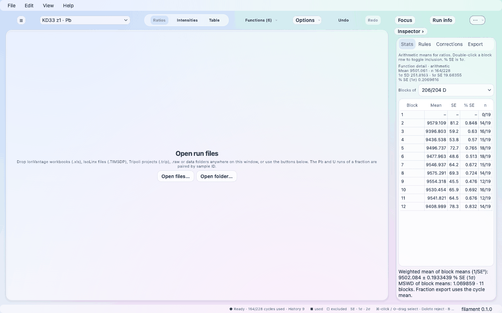
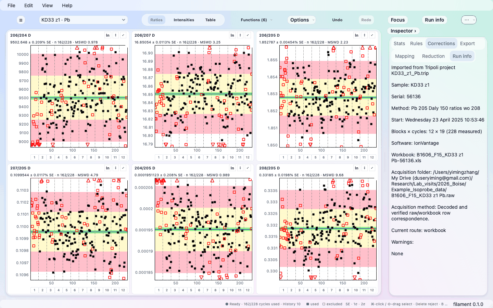
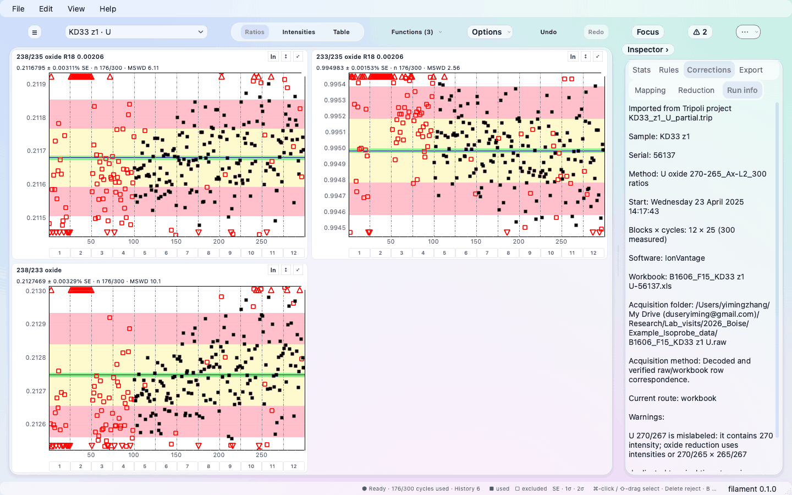
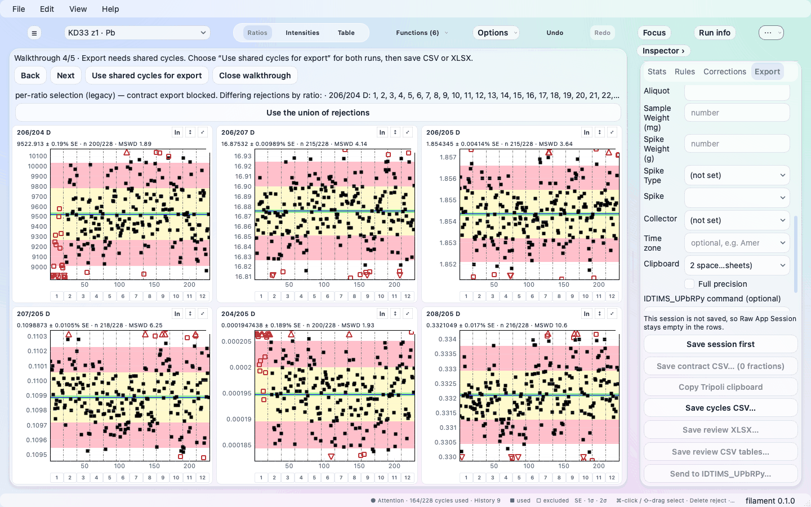

# User guide

Use filament to review measured cycles, then send ratios to your age reduction app.
Dates are calculated in IDTIMS_UPbRPy. The name remains a working name; the chosen icon is the rhenium ribbon with a glowing bead.

## Open a run

Choose **File → Open Files…** for an IonVantage `.xls`, IsoLinx `.TIMSDP`, or legacy
`.trip` project. You can drag files into the window. Choose **Open Folder…** for an
acquisition folder or a `.raw` directory; the app finds its cached workbook.
A `.raw` directory needs that workbook to open.

Choose a fraction and **Pb** or **U** in the top picker. Opening a new run does not
reject cycles. A `.trip` restores its saved, per-ratio rejections as undoable edits.
If its source is missing, use **Locate…** and choose the named workbook. Do not
substitute a similarly named acquisition.

## Review the plots

Choose **Ratios**, **Intensities**, or **Table** in the top bar. Use **Functions** to
choose what you plot. Each plot shows its mean, 1σ % SE, accepted count and block
MSWD. Filled points are used; hollow red points are excluded; crosses are invalid.
The line is the mean, and the bands show SE, 1σ and 2σ.

The wall’s **Stacked | Auto-fit** switch (also in **View**) remembers your choice.
Stacked is the default: full-width plots share cycle labels on the bottom plot
and one block strip below the wall. Auto-fit chooses columns from the available
width, with a block strip per card. Both scroll vertically when needed; switching
keeps your selections, masks and plot state.

The light and dark themes use the lab suite's quiet surfaces and filament accent.
Ratios / Intensities / Table form a segmented view switch; inspector tabs use an
underline, and the numbered workflow rail connects the existing steps. Undo,
Redo and Reset keep their short text labels, with the full action as tooltip and
accessible name. **Save contract CSV…** is the filled primary action in Export.

Plot colours follow legacy Tripoli independently of the interface accent: black
filled accepted squares, red hollow excluded squares, a blue automatic mean,
pink 2σ, pale yellow 1σ and green SE bands in light mode. Dark mode retains those
hue meanings with contrast adaptations. Ratio and intensity cards use the same
inclusion convention. See [plot colour provenance](plot-colours.md) for the
verified sources and accessibility details.

Use **ln** for a plot's log scale, **↕** to fit its vertical range, and **⤢** to
maximise it. Drag the inspector splitter to resize it. **Focus** (⌘⇧F) folds the
inspector; click it again to restore it. Use the left menu to unfold fractions.

### Tripoli controls

The action bar beside **Stacked | Auto-fit** keeps these controls visible. Existing
menus, shortcuts, Rules controls and hover tools remain available.

| Tripoli name | filament control |
| --- | --- |
| SYNCH | **SYNCH**; checked and locked for contract ratios, switchable for free functions. This controls edits, rather than copying one plot's mask to others. |
| Chauvenet | Wall **Chauvenet…** opens Rules with Java Chauvenet selected; mapped-ratio card **Ch** also chooses that ratio for evaluation. Rejections stay shared. Choose whole-run/per-block scope, then **Preview → Apply**. Other filters remain in Rules. |
| Restore plot / Replot All | Card **↺** / wall **Restore** resets the view and keeps rejections. |
| Reset All Data / legacy Restore | **Reset data…** includes every cycle and block of the current run, with confirmation and Undo. |
| Ignore Rejects | **Fit all** off fits accepted valid cycles; on includes excluded points in fitting. Rejections and statistics stay unchanged. |
| Log / Toggle ratio-logRatio | Wall **Log** / card **ln** changes the display only. |
| Toggle ALL Sculpting | Wall **Sculpt** selects Review mode in every plot; **Pan** or **Zoom** leaves it. Card **✎** toggles Review/Pan for that plot. |
| Tile / Stack | **Auto-fit / Stacked**. |
| Block include/exclude | Numbered block strip; Shift-click or drag for a range. Also **B**, plot context menu, or double-click a Stats block row. |
| Toggle block means / Toggle stats | Wall **Stats** opens block statistics; plot overlay toggles are not implemented. |
| Invert / Select all / Show all / INCLUDE | **Corrections → Mapping** supports inverse mappings; wall **Plots** shares the **Functions** menu. Independent plot inversion, bulk Tripoli selectors and legacy discard-display modes are not implemented. |

## Reject cycles

Click a point or drag a box to toggle cycles. Use ⌘-click or ⇧-drag to select
without toggling; Delete rejects the selection. Click a numbered block in the
strip below a plot to toggle that block; drag across the strip for several blocks.
The mapped ratios share a selection so their correlations remain meaningful.
**Undo** restores your previous selection; **Redo** reapplies it.

## Read block statistics

Choose **Stats** in the inspector. Select a function under **Blocks of** to see its
block means, SE, % SE and accepted counts. Double-click a row to toggle its block.
The weighted block mean and **MSWD of block means** are diagnostics. The fraction
export continues to use the cycle mean, even when you inspect block statistics.

## Check acquisition information

Choose **Run info** in the top bar, or **Corrections → Run info**. Read the method,
source, acquisition settings and current route before changing parameters.

## Check warnings

Select the U run and read **Run info**. A warning can describe the mislabeled U
`270/267` intensity column, a duplicated terminal workbook row, or an unavailable
raw method. Warnings also travel into export provenance. A successful workbook
comparison does not validate the physical detector calibration.

## Preview a 2σ rule

Choose **Rules → Legacy 2σ (one pass)**. Choose **Whole run** or **Per block**, then
**Group union** for shared rejection. Press **Preview**. Amber points mark the
proposal; the accepted cycles have not changed. **Discard** removes the preview.

Legacy 2σ compares currently accepted positive values with their arithmetic mean
and SD once. It differs from the separate iterative k-σ option.

## Apply Chauvenet rejection

Choose **Legacy Chauvenet (repeated)**, set P (normally 0.5), then **Preview**.
Inspect the proposed exclusions and press **Apply** to record exactly that proposal.
Use **Undo** to reverse it. This rule removes the worst point and recalculates
repeatedly; **Java Chauvenet (one pass)** is a different option, with a minimum count.

Leave **Per-ratio masks (legacy)** off for shared export. If a restored `.trip` has
different masks, **Use the union of rejections** adopts shared cycles and changes
the means. You can undo it. Ordinary contract and review-table exports require it.

## Change reduction parameters

Choose **Corrections → Reduction**. Expand **Edit parameters (staged)**. Select
**Raw acquisitions** only when the panel reports verified raw/workbook correspondence.
Otherwise read the reason and use the labeled workbook approximation where supported.

Edit dead time, gain, baseline, beam interpolation, acquisition rejection or oxide
settings, then press **Apply**. Editing fields alone does not change the result.
Scroll to read the parameter and ratio diff. Collapse the editor to give the diff
more room. **Discard** drops staged edits; **Reset** stages the acquired settings
for another Apply. Undo/Redo restores calculated values and parameters together.

## Save your session

Choose **File → Save Session…** (⌘S) before export. The session records selection,
mapping, parameters and history, and checks source hashes when reopened. Keep your
source files available. An unchanged saved session adds its link to the contract;
unsaved edits leave that link empty. **Save session first** saves both in sequence.

## Export ratios and review tables

Choose **Export**. Resolve every listed problem, confirm the fraction ID, spike,
weights, collector and time zone, and check the preview. Scroll inside the panel
for metadata fields. Choose **Save contract CSV…** for `idtims-fractions/1`,
**Save review XLSX…** for Fractions/Cycles/Provenance sheets, or **Save review CSV
tables…** for the same tables as files. **Save cycles CSV…** writes the current run
with inclusion flags. **Copy Tripoli clipboard** uses the legacy eight-significant-
digit format unless you choose full precision.

## Send to IDTIMS_UPbRPy

Choose **Send to IDTIMS_UPbRPy…** and a destination folder. The app saves a contract
CSV and opens the age app when it finds it. If it cannot, it reveals the saved file
so you can open it yourself. To choose a specific command, scroll to **IDTIMS_UPbRPy
command (optional)**. It runs without a shell and receives `--open PATH`.

## Walkthrough: open KD33 z1

Choose **Help → Walkthrough: change the dead time**. If unavailable, choose
**Help → Choose walkthrough examples folder…** and point to the read-only Boise
examples. Step 1 opens KD33 z1 Pb and U with the exact legacy per-ratio masks.
Keep those masks while comparing the reference numbers below.

## Walkthrough: stage 36.3 → 40 ns

Press **Next**. In **Corrections → Reduction**, select **Raw acquisitions** and
change **Pb Daly dead time (ns)** from **36.3** to **40**. Leave U as acquired.
Press **Apply**, then **Next**.

## Walkthrough: compare the changes

Collapse **Edit parameters (staged)** and read the diff. Undo and Redo to compare.
The GUI compares the acquired workbook with raw reprocessing at 40 ns. With the
legacy masks, the means are:

| Pb ratio | Acquired workbook, 36.3 ns | Raw, 40 ns |
|---|---:|---:|
| 206/204 | 9506.74273898 | 9522.91320034 |
| 206/207 | 16.8481791298 | 16.8753245427 |
| 206/205 | 1.85288460605 | 1.85434498117 |
| 207/205 | 0.109977609179 | 0.109887251956 |
| 204/205 | 0.000194922464478 | 0.000194743834362 |
| 208/205 | 0.331843285849 | 0.332104897448 |

The raw-to-raw mean changes are about +0.17010%, +0.16112%, +0.07882%, −0.08216%,
−0.09165% and +0.07883%, respectively. U means and % SE stay identical.

## Walkthrough: compare reference dates

Read these dates from the separate age engine, with the same legacy masks and
fixed tracer/blank/fractionation/Th-correction settings. They are reference results,
not live dates calculated by this viewer.

| Date (Ma) | Acquired workbook, 36.3 ns | Raw, 40 ns | Change (Ma) |
|---|---:|---:|---:|
| 206/238 | 545.723740 | 546.137511 | +0.413772 |
| 207/235 | 545.751695 | 545.409137 | −0.342557 |
| 207/206 | 545.868422 | 542.366971 | −3.501450 |

See [the recalculation demonstration](recalculation-demo.md) for 2σ uncertainties,
raw 36.3 ns controls, settings, route differences and reproducibility.

## Walkthrough: adopt shared cycles

Press **Next** for step 4, then **Use shared cycles for export**. This takes the
union of rejections in Pb and U. It changes the means and dates from the reference
tables above; do not treat those legacy-mask dates as your shared-cycle result.
Check the Export preview, save the session and export CSV or XLSX.

## Walkthrough: hand off the result

Press **Next** for step 5 and choose **Send to IDTIMS_UPbRPy…** when ready.
Calculate dates there using your intended reduction settings. Starting or capturing
the walkthrough never launches the age app automatically.

## Recreate these screenshots

Run `env -u PYTHONPATH .venv/bin/python scripts/capture_guide.py` in the checkout.
The script forces Qt offscreen, uses isolated settings, and writes 1440×900 PNGs
under `docs/guide/` (each at most 250 KB). It reads Drive inputs without writing
there. Without the examples it uses public fixtures and skips walkthrough shots;
those image links then have no local image. `--fixtures-only --output /tmp/guide`
checks that fallback without replacing this guide's KD33 screenshots.

For remaining differences from Tripoli, read [the feature gap list](tripoli-gap.md).

## Review diagnostics and display controls

Open **View → Review diagnostics**, also available under the plot wall's options.
These controls change presentation. Rejections, reduction settings, mapped ratios,
and fraction-export values keep their existing meanings.

- **Histogram / x–y / time / oxygen** opens a read-only view. Histogram bins share
  edges for accepted and rejected counts and count every finite cycle, including
  zero. Tripoli's bin-edge epsilon and rightmost-bin convention are retained.
  Choose any two existing functions for x–y; hover a dot for its original cycle,
  block and displayed coordinates. A dot is accepted when both axes accept it.
  Optional intensity scaling uses minimum/maximum radii in pixels. Time views use
  recorded elapsed seconds and report missing times without inventing an axis.
- **Save recipe** remembers axes, intensity, bin count, radii, color and inversion
  in the session. Load checks that the functions exist; Delete removes a recipe.
  Recipes are presentation metadata and do not author new reduction functions.
- **Oxygen monitor** requires a source ratio with masses 272/270 and explicit
  verification from the method that these are 238U16O18O / 238U16O2 with
  dimensionless units. Only then is `(272/270)/2` shown. Verification is off on
  opening and is never carried by a recipe. The monitor never replaces acquisition
  r18, feeds oxide correction, or enters an export mapping.
- **Session and work-product notes** edits plain text for the session, selected
  run, fraction, or named sample. Save the session to retain notes and recipes;
  Cancel discards edits. Text is never treated as markup or code. Session identity
  and SHA provenance continue to reflect the saved file, including its notes.

**Block-mean overlay** draws existing block means without changing the estimator.
Right-click a plot and choose **Zoom to block** for a view of one block; Restore
returns to the full range. Statistics can be hidden or shown with **2σ, σ, SE**,
**σ, SE**, or **SE** bands. These settings and rejection-display mode are remembered.

The default **Pinned** view retains hollow excluded points pinned at the edges.
**INCLUDE** fits all finite values without including rejected values in statistics.
**IGNORE** retains cycle positions but fits accepted values and leaves outliers
outside that range. **HIDE** removes rejected positions and closes up the axis;
original cycle IDs remain attached to clicks and hover, and block separators are
suppressed as in C# Tripoli. Missing/invalid rows are not treated as outliers.
Each HIDE plot has its own compressed positions, so its x zoom is independent.

**Invert all displays**, or **Invert display** in a plot's right-click menu, plots
reciprocals and labels them “display inverse.” Plot readouts and bands use statistics
of those reciprocal values; this is separate from Mapping inversion. A block overlay
shows the reciprocal of each stored block mean. **Freeze displayed statistics**
holds the plot mean, bands and accepted-count readout at a labeled snapshot while
points continue to update. Inspector and exported statistics always remain current.
Unfreeze refreshes the snapshot; rebuilding the view takes a new snapshot. Inversion
and freeze are transient deliberate actions, not saved reduction settings.

Use **Plot all functions in this view** or select rows in the Functions picker and
choose **Show selected function rows** to change plot visibility. Neither changes
export membership. Right-click a plot for remembered point color and diameter.

**Save plot pages as PNG** and **Print plot pages** output every plotted function
in its current order, including plots below the scrolling viewport. Graph sheets
arrange four plots per page. Diagnostic windows have their own PNG/Print buttons.
Images retain the current display direction, zoom, titles and frozen labels;
they are review artifacts rather than replacements for numerical exports.
